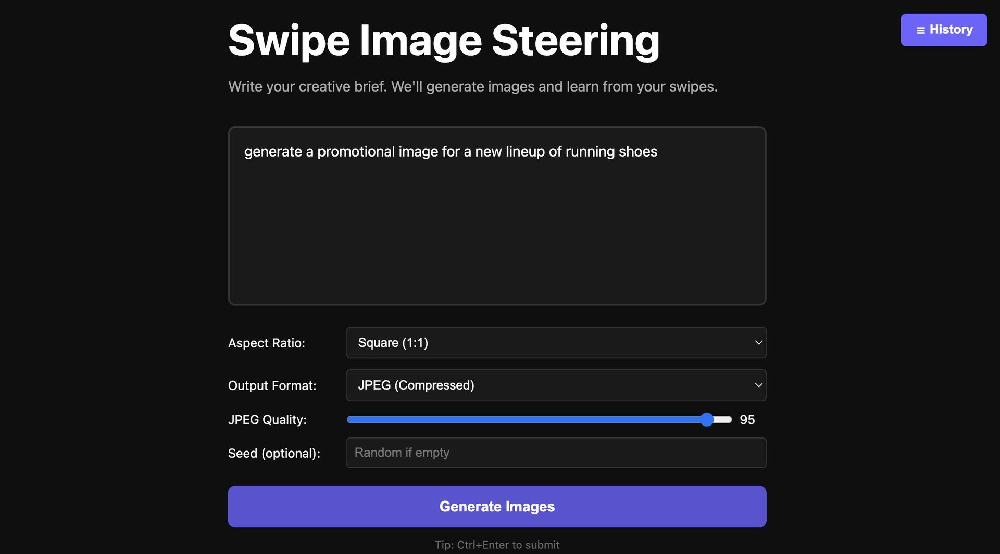
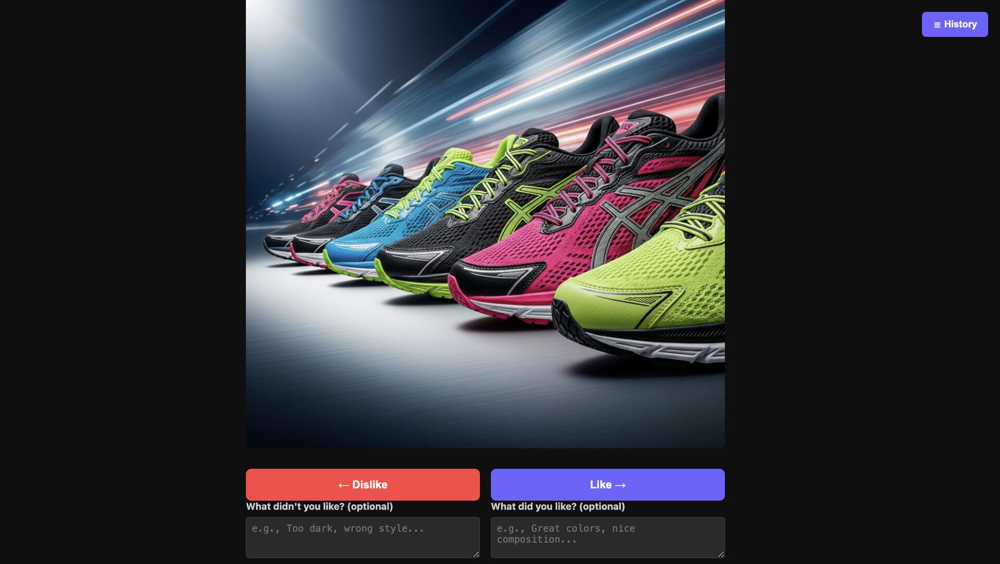
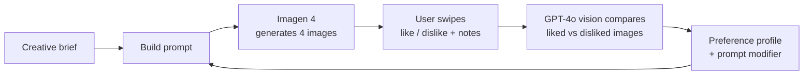

# Swipe Image Steering

Steer AI image generation by swiping instead of rewriting prompts.

You write a creative brief and get four generated images. You like or dislike each one and can add a short note on why. A vision model then works out which visual qualities you're responding to and rewrites the prompt for the next batch. Each round should get closer to what you had in mind, even if you couldn't put it into words at the start.





## Why

Text prompts are a poor way to describe visual taste. People can usually say "more like this one, less like that one" well before they can say "cooler colour temperature, lower camera angle, less clutter". This project tests whether quick yes/no reactions, plus an occasional note, are enough to steer an image model toward what someone actually wants.

## How it works



1. **Generate.** The brief, plus any modifier learned so far, goes to Google Imagen 4, which returns four images.
2. **React.** For each image you swipe left or right (buttons or arrow keys) and can add a note such as "too dark" or "love the motion blur".
3. **Analyze.** GPT-4o is sent the liked and disliked images, your notes, the original brief and the previous preference profile. It returns structured JSON: a plain-English summary, the visual attributes you liked and disliked (palette, lighting, composition, texture, mood, style), and a short phrase to add to the next prompt.
4. **Repeat.** The new prompt is `brief + modifier`. The previous profile is passed back into each analysis, so the model can resolve contradictions between rounds rather than starting over.

The history panel keeps every round's images and choices, so you can see how the images changed.

### Design decisions

- **Images, not just prompts, go to the analysis model.** The same prompt produces very different images, so the analysis looks at what was actually generated rather than guessing from text.
- **Structured JSON output.** The analysis must return a fixed schema, so the UI can show the summary and attributes reliably and the backend can use the modifier directly.
- **Notes are optional.** Swiping alone works. A note helps when the reason for a dislike isn't visible, for example "wrong brand feel".
- **No database.** Sessions live in memory on the FastAPI server, which keeps this prototype simple. A restart clears all sessions.

## Tech stack

| Layer | Choice |
|---|---|
| Frontend | React 18, TypeScript, Vite |
| Backend | Python, FastAPI, Pydantic |
| Image generation | Google Imagen 4 (`imagen-4.0-generate-001`) via the `google-genai` SDK |
| Preference analysis | OpenAI GPT-4o with image input |
| Storage | In-memory (no database) |

## Project structure

```
backend/
  main.py            FastAPI app: /session/start, /session/swipe, /session/next, history
  imagen_client.py   Imagen 4 image generation
  gpt_client.py      GPT-4o preference analysis (images + notes -> JSON profile)
  prompt_engine.py   Combines the brief with the learned prompt modifier
  models.py          Pydantic models: Session, Round, ImageRecord
  session_store.py   In-memory session storage
  scripts/           One-off API experiment scripts (not part of the app)
frontend/src/
  App.tsx            Moves between the brief, swiping, summary and loading screens
  components/        BriefInput, SwipeCard, SummaryCard, HistoryPanel
  hooks/useSession.ts  Session state and API calls
  api/client.ts      Typed API client
```

## Running it locally

You'll need your own API keys. Generating images and running the analysis are billed by Google and OpenAI.

**Prerequisites:** Python 3.11+, Node.js 18+, a Google AI (Gemini API) key with Imagen access, and an OpenAI API key.

**Backend** (http://localhost:8000):

```bash
cd backend
python -m venv .venv
source .venv/bin/activate        # Windows: .venv\Scripts\activate
pip install -r requirements.txt
cp .env.example .env             # then add GOOGLE_API_KEY and OPENAI_API_KEY
uvicorn main:app --reload
```

**Frontend** (http://localhost:5173), in a second terminal:

```bash
cd frontend
npm install
npm run dev
```

Open http://localhost:5173, write a brief and click **Generate Images** (or press Ctrl+Enter).

## Limitations and next steps

- Sessions are stored in memory and lost when the server restarts.
- The analysis sees at most two liked and two disliked images per round, to keep token costs down.
- The prompt modifier replaces the previous one each round instead of building up. The profile carries context forward, but long sessions could still drift.
- Possible next steps: persistent storage, comparing rounds side by side, and letting the user edit the learned modifier directly.
